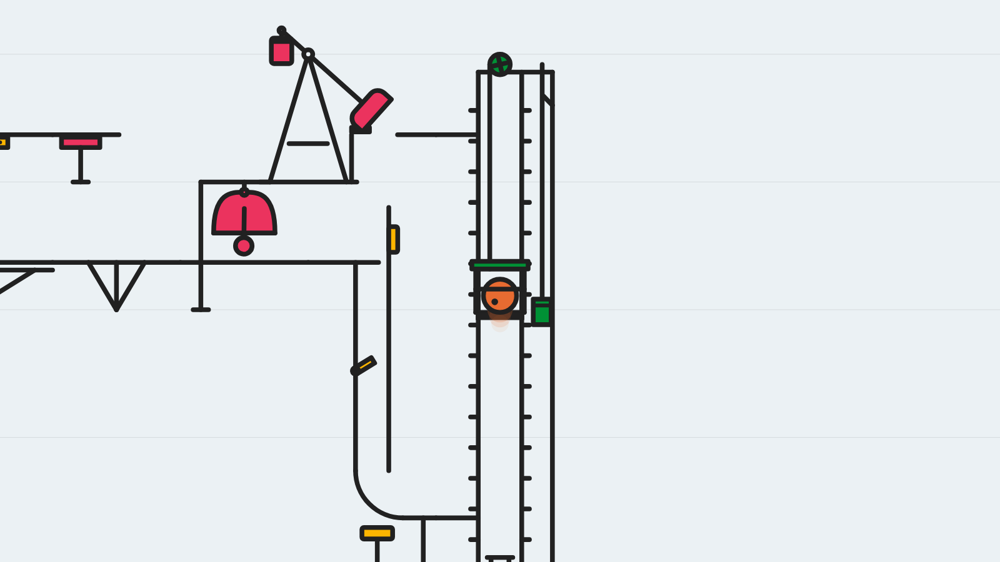
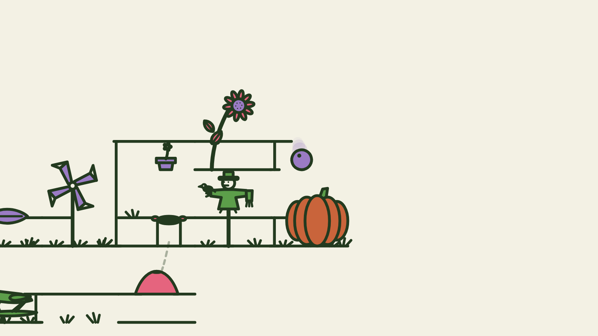
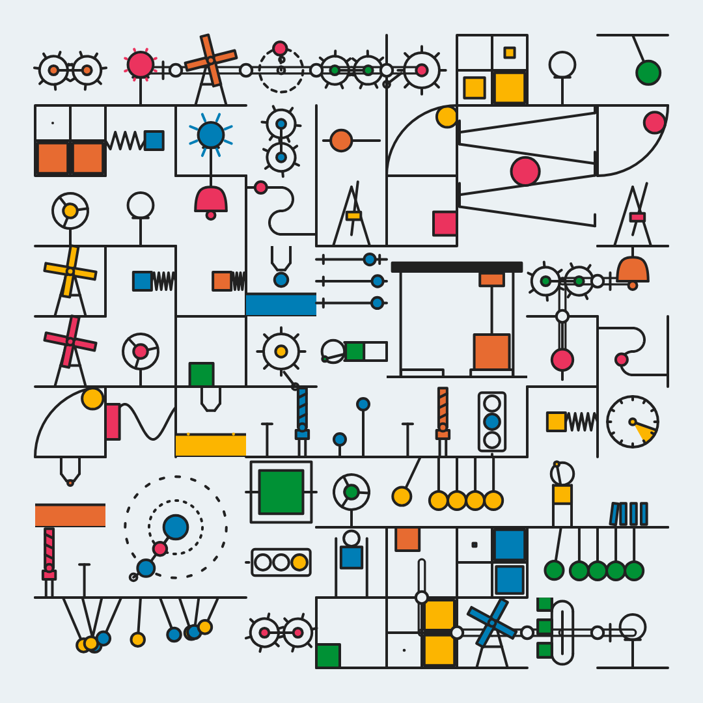

# contraptions

Small animated machines.

[Machine](https://contraptions-wustep.vercel.app/) is the front door. One ball runs a Rube Goldberg chain that never ends, and the camera follows it. At the end of a map the ball hits a portal, and the next map is a different place: new pieces, a new palette.

[Explorations](https://contraptions-wustep.vercel.app/explorations/) is the generator Machine grew out of. It fills a grid with tiny machines that loop on their own. Every control is in the URL, so a frame you like is a link you can share. Heavily inspired by [Okazz](https://x.com/okazz_/status/2090999902805393607).

## Machine

The chain visits four worlds, always in the same order: Regular, Forest, Aqua, Arcade, then back to Regular. Regular is a workshop, Forest a garden, Aqua a harbor, and Arcade an arcade. Each world has its own pieces. A seed chooses the palette, which pieces show up, and how the map is laid out.





## Explorations



There are six modes. Classic is a field of separate machines, wired together. Ports, Tracks, Cascade, Workshop, and Circus each build a different kind of grid. The panel is the same one Machine uses.

## Shows and Playground

[Shows](https://contraptions-wustep.vercel.app/shows/) is Machine set to music. A chain is choreographed to a piece, the soundtrack stays locked to the picture, and you can keep as many takes as you want side by side.

[Playground](https://contraptions-wustep.vercel.app/playground/) is where pieces and worlds wait to be let into Machine: new ones, ones that were cut, and worlds that are not in the loop yet. You can watch them the way Machine would.

The Builder is in the repo, but it is hidden for now. It is not ready.

## Run it

Node 22.

```bash
npm install
npm run dev
npm run build
```

`npm run dev` serves Machine at [http://localhost:8791/machine/](http://localhost:8791/machine/). `npm run build` writes one `dist/` with the same paths. One Vite app serves every mode, in dev and in the build.

`npm run build` is the full verification: lint, typecheck, every check suite (`npm run verify`), then the site build. Run it before you push. The checks can also run separately: `npm run lint` uses Oxlint's ESLint and TypeScript correctness rules, `npm run typecheck` checks application code, scripts and the Vite config, and `npm test` runs every headless check suite.

Vercel runs only the site build (`npm run build:site`, set in `vercel.json`), and skips the build entirely when a push changes only docs and notes (`*.md`, `ideas/`, `docs/`, `notes/`; `scripts/vercel-ignore-build.sh`). When it can't tell, as on a branch's first deployment, it builds. Everything under `/assets/` is named by its content, so `vercel.json` lets browsers keep it for a year without asking again; the pages themselves are always checked. The checks run on GitHub Actions instead: the `build` check (`.github/workflows/build.yml`) runs `npm run build` on every pull request to `main` and every push to `main`. Each push to GitHub starts a paid Vercel build, so commit locally and push once per round of work, not after every commit.

## Addresses

| Path | What is there |
| --- | --- |
| `/machine/` | Machine |
| `/explorations/` | Explorations |
| `/shows/` | Shows, opening on Clair de Lune |
| `/shows/<work>/` | a show: the work's first take, with its own share card |
| `/shows/<work>/<take>/` | one take of a show, with its own share card |
| `/theater/` | every show is listed with a box, shuffled one after another over the ticked ones; the favourites (starred, each in its starred take) are ticked to begin with, and what is ticked is remembered. It joins the mode switch only once you have been there |
| `/playground/` | Playground |
| `/builder/` | the Builder (hidden) |

Old links still work. `/` goes to `/machine/`, `/sandbox/` to `/explorations/` and `/rube/` to `/machine/`, all keeping the query. `/shows/?show=<work>&take=<take>` still opens a show, and so does `/theater/?show=<work>&take=<take>`. A take that has been renamed still opens at its old address (`/shows/la-la-land/opus55-sebs/` is now `/shows/la-la-land/opus5-5/`). A path without its trailing slash works too. `<work>` and `<take>` are folder and file names under `apps/rube/src/shows/versions/`; see its README.

## Where things are

```
machine/, explorations/, shows/, theater/, playground/, builder/   one page per mode
index.html, sandbox/, rube/     old addresses, which only redirect
src/                          Explorations, and what every mode shares
  core/  contraptions/  worlds/  ui/
apps/rube/                    Machine, and the modes built on it
  src/pieces/                 the pieces, a folder per world
  src/shows/                  Shows and Theater: player, soundtrack, share cards; STOCK_SHOWS_PLAN.md, REVIEW_STATUS.md
    versions/<work>/          one piece of music: its takes (*.show.ts), recording, attribution and write-ups
  src/playground/             pieces and worlds waiting to be let in; REJECTED.md
  src/builder/                the Builder (hidden)
  builds/                     the Builder's shipped builds
  checks/                     headless checks, run by npm run build and CI (not on Vercel)
scripts/                      Explorations' check, and new-contraption
  shows/                      arrangements, onset measurements, audio mixes, share cards
    plans/                    piece orders and measured onsets the shows are built from
public/                       share cards (public/shows/<work>/<take>.png) and other files served at the root
```

Each show's notes live beside it, in `apps/rube/src/shows/versions/<work>/`. The recordings there are for private demos only; see each `ATTRIBUTION.txt`.

## License

Released under the [MIT License](LICENSE). Copyright Stephen Wu, 2026.
