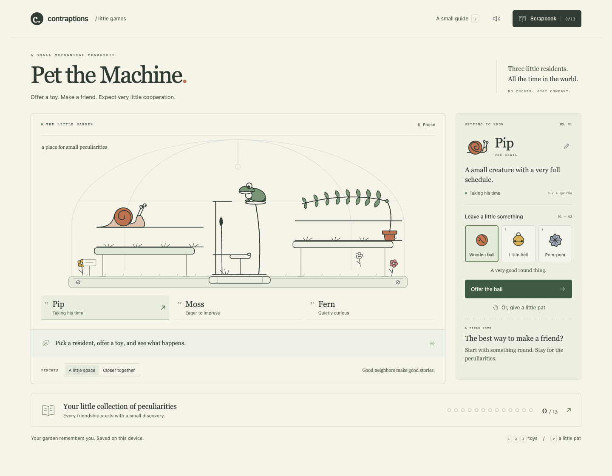
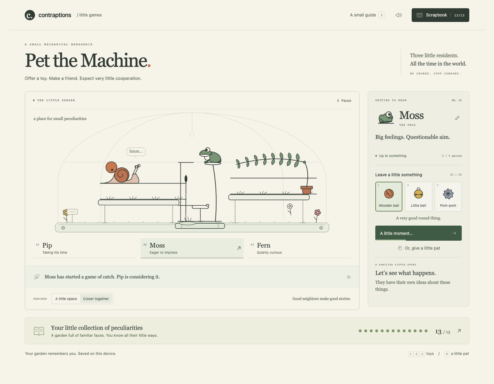
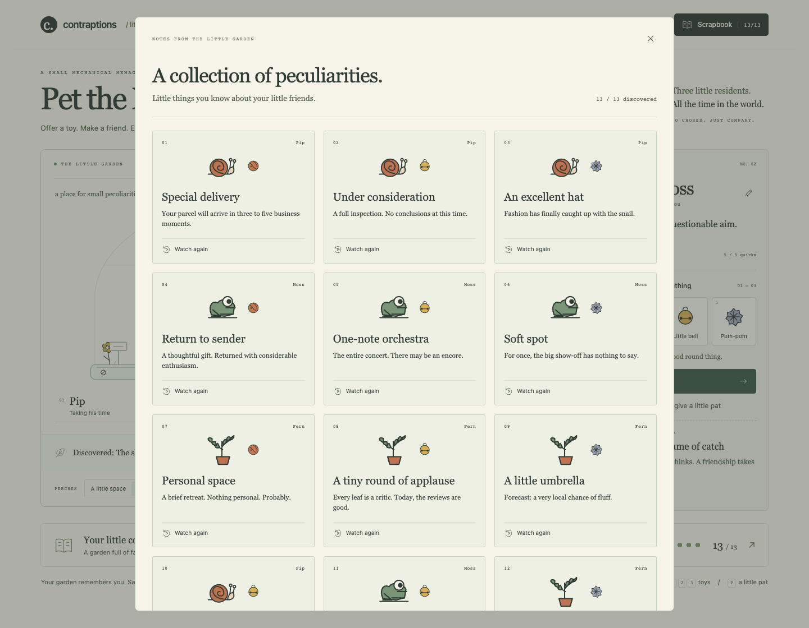
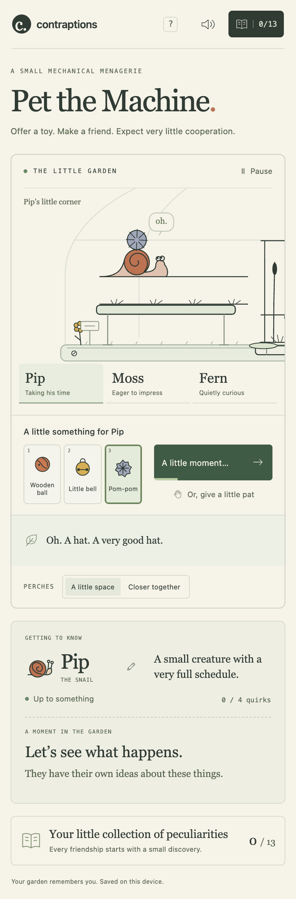
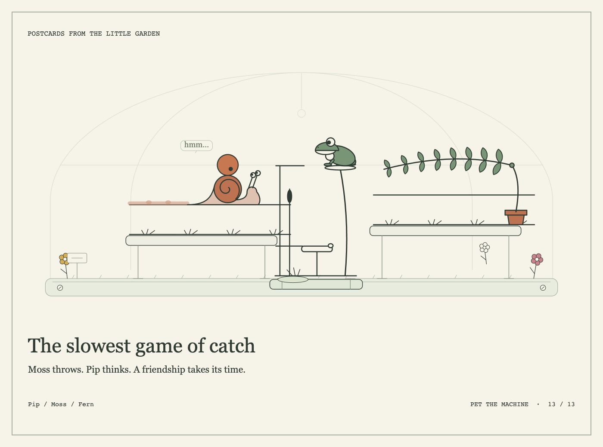

# Pet the Machine

A little mechanical garden at `/games/pet-the-machine/`. Meet Pip the snail, Moss the frog, and Fern the sensitive plant. Offer a wooden ball, a little bell, or a pom-pom; collect thirteen peculiar reactions. A visit takes about a minute. Individual stories take four to ten seconds. There are no chores, timers, or lost progress between visits.

[Branch preview](https://contraptions-git-game-pet-wustep.vercel.app/games/pet-the-machine/)

## Play

Choose a resident, choose a toy, and offer it. Try the same gift twice, give a gentle pat, or bring the perches closer together. After meeting Pip and Moss, offer Moss the ball with neighboring perches to start their very slow game of catch. Rename each friend with the pencil. Discoveries, names, perches, and sound preference stay on this device.

The scrapbook offers optional hints and replays. A completed story can become a 1400 × 1040 PNG postcard, framed at an authored moment. Replays preserve the original decision and do not change interaction memory or count as new visits.

Keyboard: left/right selects a resident; 1–3 selects a toy; Enter offers it when focus is outside another control; P gives a pat; Space pauses when focus is outside a button; ? opens the guide. Buttons also retain their native keyboard behavior. Dialogs support Escape and focus return. Reduced motion stops idle movement and camera transitions; the short story itself remains playable and can be paused.

## Engine integration

- `model.ts` resolves a choice from bounded local memory before anything moves. Storage is versioned, validated, escaped at HTML boundaries, and optional: blocked storage still permits a complete visit.
- `performance.ts` loads the stock snail and frog and dynamically loads Playground's mimosa. It composes their lanes with `fly`, `wait`, and `trace`; retimed actor clocks match the toy path. The frog's hidden mouth segments survive sampling. The mimosa's fluffy passenger follows the rib's authored geometry.
- `garden.ts` uses `drawWorld`, `setupCanvas`, `Show`, `Universe`, and curated `Placed` data. It never asks overlapping objects to collide. The app owns one local clock and pauses it for dialogs, explicit pause, and background visibility. Phone framing follows the selected resident; paired stories use a wider view.
- `sound.ts` synthesizes quiet, dry Web Audio cues after a user gesture. Audio never drives the clock. No external assets or services are needed to play.
- Only the new Vite entry and slashless game route are added to site routing. Vercel serves the generated `games/pet-the-machine/index.html` through its existing static deployment. Existing pages, piece implementations, shelves, and registries are unchanged. Playground's lazy-load build guard remains active.

## Browser play-test and improvement passes

Performed in real Chrome through DevTools and Playwright on October 17, 2026. Each pass included play, observed problems, changes, and replay.

| Pass | Observed | Changed and replayed |
| --- | --- | --- |
| 1 — reactions and feedback | Small control labels; unclear focus during a story; the last friend's field note remained after selecting another friend; a pom-pom floated above Fern; the hidden frog mouth used the wrong toy color. | Enlarged labels and scene framing; added small ink thought bubbles; kept field notes per resident; attached the fluffy toy to the moving rib; preserved toy color and visibility; added a receiving dish and a short return animation. Played eight complete stories, including both repeat jokes and the shared catch, downloaded a postcard, and reloaded the saved collection. |
| 2 — phone play | The toy controls were below the scene and the whole garden made the residents too small on a phone. | Moved the same live controls under the scene at phone widths and added resident closeups with wider framing for catch. Played five stories using touch, including the hat and trust reactions; checked pause/resume, rename/reload, and widths 320, 390, 520, 768, 1024, and 1440 without horizontal overflow. |
| 3 — accessibility, saving, and exports | Several muted labels lacked contrast; a blocked store initially claimed to have saved; a crafted saved name could become markup; phone postcards depended on viewport size. | Darkened text, reported storage availability immediately, escaped names and made substitutions safe, and rendered postcards at a fixed size and double density while restoring the live camera. Earned all 13 discoveries through visible controls, replayed catch without mutating memory, and checked keyboard, rapid inputs, dialog pause, mute/rename persistence, reduced motion, denied/corrupt storage, interrupted offers, and desktop/phone PNG downloads. No browser errors. Axe WCAG A/AA scans reported zero violations on the desktop, phone, and scrapbook views. |

The first full build exposed a source-based legacy slash-route check. Keeping the new nested game alternative after the existing Shows alternatives preserved that check without changing existing tests.

## Checks

Use Node 22. Install project dependencies with `npm ci` if needed.

```sh
npm run dev -- --host 127.0.0.1 --port 8797 --strictPort
npm run check:pet
npm run build
```

`check:pet` is included in `npm test` and the full build. Its 23 checks cover all discovery conditions, corrupted and valid saves, names, replay determinism, every lane join and frame, hidden frog segments, cue ordering, bounded duration, and routing. The full build also runs all existing lint, TypeScript, machine, builder, playground, show, and score checks.

The browser play-through is committed without adding a runtime or repository dependency. With Chrome installed:

```sh
npm install --prefix /tmp/pet-browser --no-audit --no-fund playwright
PLAYWRIGHT_MODULE=/tmp/pet-browser/node_modules/playwright/index.mjs \
  node scripts/games/playtest-pet.mjs
```

`PET_BASE_URL` can point at a local production preview (default `http://127.0.0.1:8797`). `PET_ARTIFACTS` chooses the screenshots/download directory (default `out/pet-qa/final`, ignored by Git).

## Screenshots

These are browser captures from the final play-through. The postcard is an actual game download.










